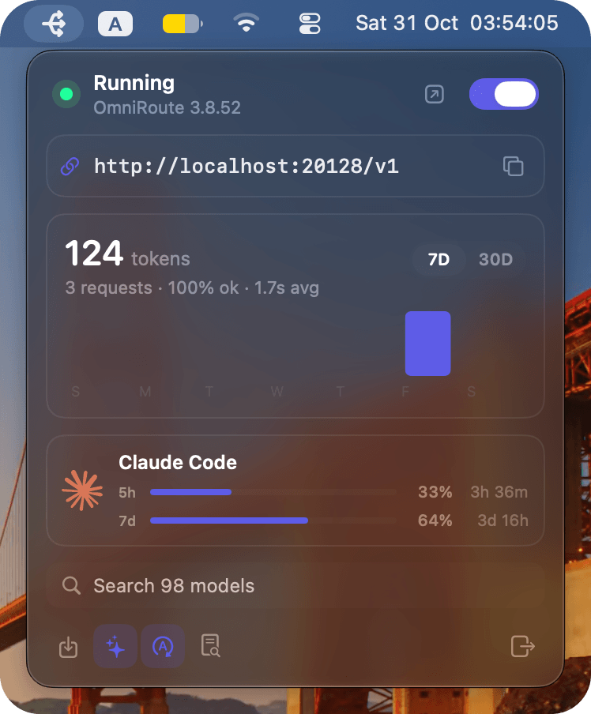

<p align="center">
  
</p>

<h1 align="center">RouteBar</h1>

<p align="center">
  The quiet way to run <a href="https://github.com/cheaper-inference/OmniRoute">OmniRoute</a> on a Mac.<br>
  One endpoint, your subscriptions, every model. Right in the menu bar.
</p>

<p align="center">
    
</p>

## Why

OmniRoute is a powerful AI gateway, and its dashboard shows every one of those powers at once.
Most days you only need four things: the endpoint, a switch, how much you used, and the exact
name of a model. RouteBar puts exactly that in the menu bar and keeps the full dashboard one
click away.

## Install

```sh
brew trust --cask spilneo/tap/routebar
brew install --cask spilneo/tap/routebar
```

Homebrew only loads casks from third-party taps you trust, so the command trusts RouteBar first.

RouteBar needs macOS 14 Sonoma or later. Homebrew also installs Node.js, which OmniRoute runs on.

## First launch

1. Open RouteBar. The three-arrow icon appears in the menu bar.
2. RouteBar starts OmniRoute on port 20128. If `omniroute` is not installed globally, it is
   fetched with `npx`, so the very first start can take a minute or two.
3. Every AI tool you are already signed in to is connected for you. RouteBar runs each
   local-login importer OmniRoute offers and names what it adds from OmniRoute's own provider
   list, so there are no files to upload and nothing to configure. Today that covers:

   | Tool          | Where the login is found                                   |
   | ------------- | ---------------------------------------------------------- |
   | Claude Code   | the macOS Keychain, or `~/.claude/.credentials.json`       |
   | Codex         | `~/.codex/auth.json`                                       |
   | Grok CLI      | `~/.grok/auth.json`                                        |
   | Cursor        | the Cursor app or `cursor-agent`                           |
   | Kiro          | the Kiro app or CLI                                        |
   | Antigravity   | the Antigravity CLI token                                  |
   | CLIProxyAPI   | every account in `~/.cli-proxy-api`                        |
   | Zed           | the macOS Keychain, only when you ask (see below)          |

   Imports never overwrite a connection. Zed keeps its keys in the Keychain behind a macOS
   prompt, so it is only read when you click the import button in the footer, which
   also catches tools you signed in to after launch. OpenCode is not listed because OmniRoute
   has no importer for its logins yet.
4. Copy the endpoint and paste it into any OpenAI-compatible app. RouteBar shows this Mac's
   network address, for example `http://192.168.68.53:20128/v1`, so the same URL also works from
   other devices on your network. It falls back to `localhost` when OmniRoute does not answer on
   the network address, and Settings can always show `localhost` instead. Requests from other
   devices need one of your OmniRoute API keys. Requests from this Mac do not.

```sh
curl http://localhost:20128/v1/models
```

## The panel

| Section       | What it shows                                                                                         |
| ------------- | ----------------------------------------------------------------------------------------------------- |
| **Header**    | Whether the endpoint is running and how many requests it is serving right now, the OmniRoute version (with a note when an update is out), a button to the full dashboard, and the on/off switch. |
| **Endpoint**  | The base URL for your apps, with a copy button. The network address by default, `localhost` on request. |
| **Usage**     | Tokens and requests over 7 or 30 days. Hover a bar to see that day.                                   |
| **Providers** | Each connected provider with its logo and live subscription limits, shortest window on top, such as Claude's 5-hour window above the weekly one. Meters turn orange at 80% and red at 95%, and show when each window resets. A provider with several accounts shows how many, and its meters follow the busiest account. Click a tile to see every account with its own limits. More than eight providers scroll. |
| **Models**    | Only the models your active providers serve. Click the search bar to unfold the list inside it; nothing is focused until you do. Type to filter, use the arrow keys and Return to copy, click a row to copy it, or press Esc to fold it away. The refresh button asks every active provider for its current models, which picks up new releases. Each provider is also refreshed once automatically when RouteBar first sees it. |
| **Footer**    | Icon buttons, each explained on hover: import logins now, show the OmniRoute log, Settings, RouteBar on GitHub, and quit. A faint RouteBar mark with the version sits between them. |

## Settings

The gear opens Settings in the panel.

- **Appearance.** Pick the accent colour from eight presets (teal by default), and turn the translucent panel off
  for a solid background.
- **Server.** Manage the OmniRoute on this Mac or one on another machine (see below).
- **Endpoint.** Show the network address or `localhost`.
- **General.** Automatic login import and Open at Login.

## Remote servers

RouteBar can watch and control an OmniRoute running on another machine, such as a home server
or a VPS. In Settings, choose **Remote server**, enter its host or URL (for example
`192.168.1.20` or `https://ai.example.com`), and sign in with either:

- **Password.** The server's management password. RouteBar exchanges it once for a scoped
  access token, the same way `omniroute connect` does, and does not keep the password.
- **Access token.** An existing `oma_` token, for example from `omniroute tokens create` on the
  server.

The token is kept in your macOS Keychain. While connected, the panel shows that server's status,
endpoint, usage, providers, limits and models, and the switch can stop it after you confirm. A
stopped remote server has to be started on its own machine, for example with
`omniroute autostart`, because nothing on your Mac can start a process there. Login import and
the log stay with the OmniRoute on this Mac. **Forget** returns to this Mac and removes the token
from the Keychain. The token stays valid on the server until you revoke it there. Prefer `https`,
a VPN or Tailscale for servers outside your network.

The full OmniRoute dashboard is one click away for everything else, such as adding providers,
combos, API keys and routing rules.

## How it works

- **Native.** Swift and SwiftUI with Swift Charts. No web view and no bundled runtime.
- **Your servers only.** RouteBar talks to OmniRoute on `127.0.0.1`, and to a remote OmniRoute
  only when you add one. It checks whether OmniRoute answers on your network address so it can
  show that address.
- **No passwords.** Management calls use OmniRoute's own machine-bound CLI token, derived the
  same way the `omniroute` CLI does it. RouteBar keeps working after you set a dashboard password.
  That token is only ever sent to this Mac. A remote server gets its own scoped access token.
- **Clean shutdown.** Switching the endpoint off asks OmniRoute to exit, whoever started it.
  Quitting RouteBar stops the copy it launched, so no stray `node` process is left behind.
- **Credentials stay put.** Logins are read only to hand them to your local OmniRoute. RouteBar
  never stores, logs or sends them anywhere else.

OmniRoute's output is written to `~/Library/Logs/RouteBar/omniroute.log`.

## Build from source

```sh
swift test               # unit tests
./scripts/build-app.sh   # universal, ad-hoc signed RouteBar.app
open RouteBar.app
```

`./scripts/build-icon.sh` regenerates the app icon from [`logo.svg`](logo.svg) and needs
`rsvg-convert` (`brew install librsvg`).

## Releasing

1. Bump `CFBundleShortVersionString` in [`Resources/Info.plist`](Resources/Info.plist).
2. Push a matching tag, for example `git tag v1.0.1 && git push origin v1.0.1`.

The [Release](.github/workflows/release.yml) workflow tests, builds and publishes `RouteBar.zip`.
The [tap](https://github.com/spilneo/homebrew-tap) picks up the new version on its next scheduled
run. To update it immediately, add a `HOMEBREW_TAP_TOKEN` secret with write access to the tap.
